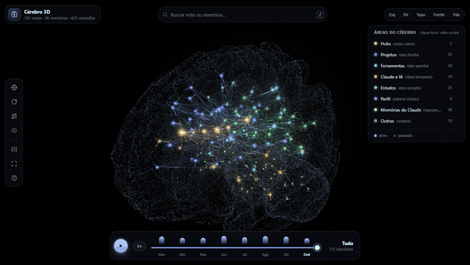
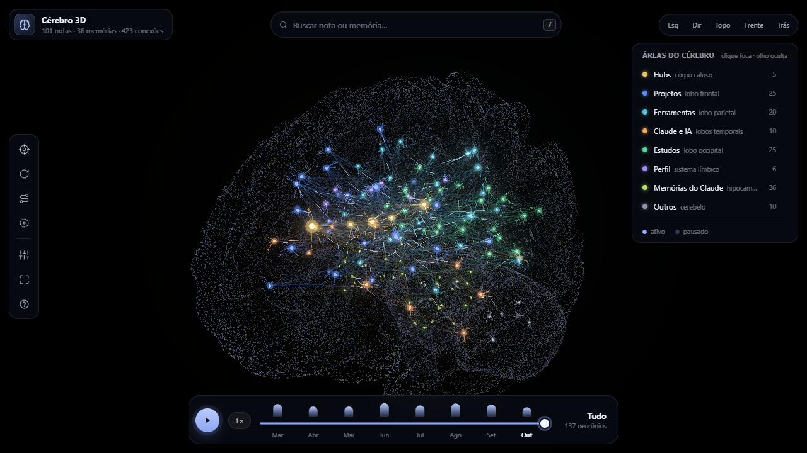
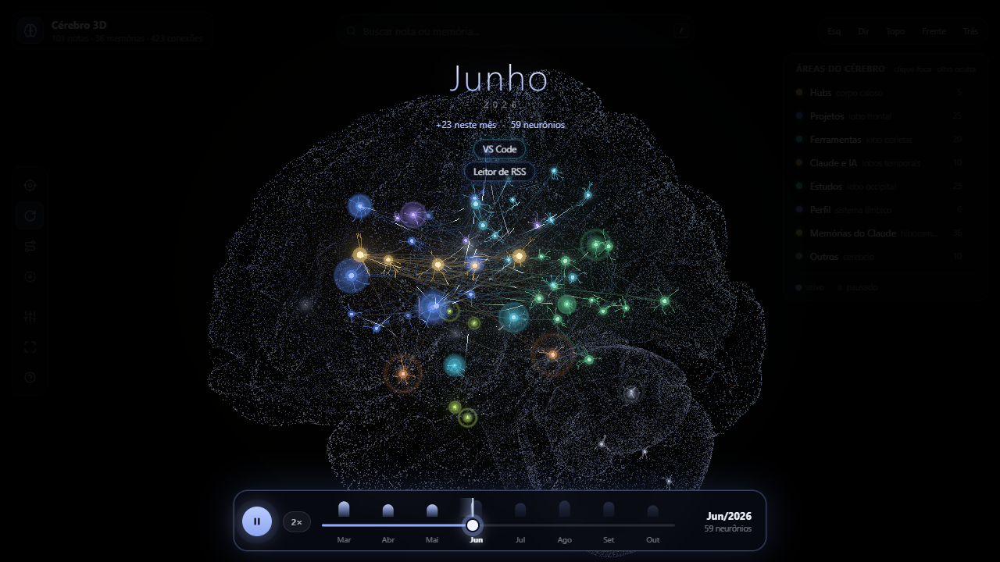
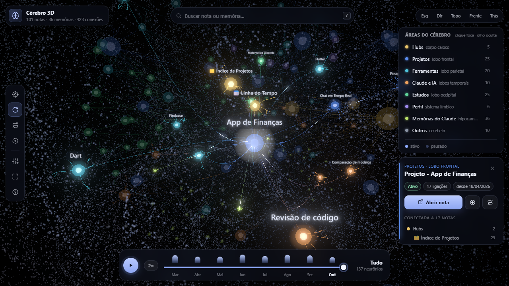
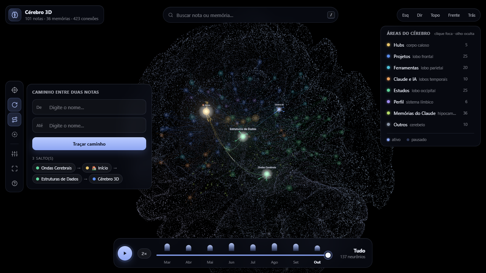
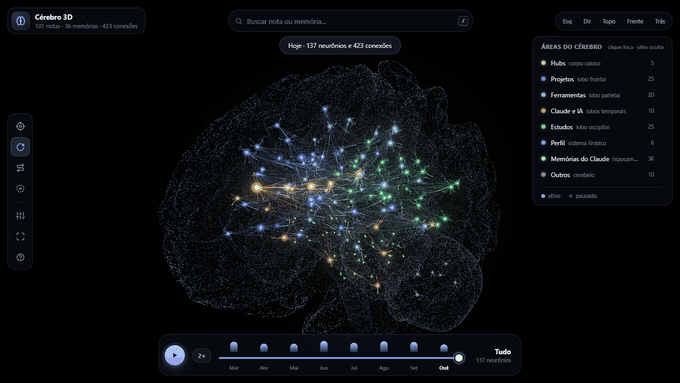
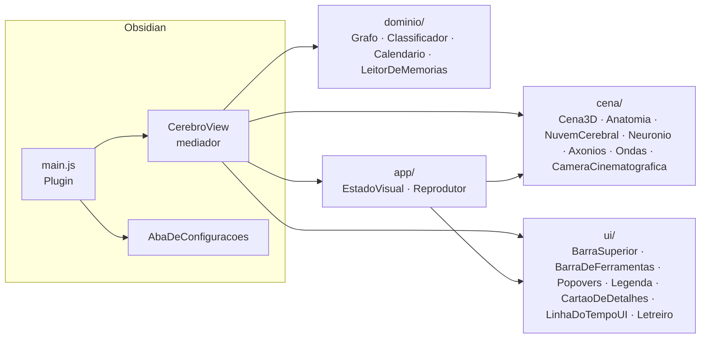

<div align="center">

# 🧠 Cérebro 3D

**Seu vault do Obsidian como um cérebro de verdade — cada nota é um neurônio, cada link é um axônio.**

[](https://obsidian.md)
[](https://github.com/Marcos-Codfy/obsidian-cerebro-3d/releases)
[](https://threejs.org)
[](LICENSE)




<sub>Demonstração com um vault fictício · linha do tempo em play (2×)</sub>

</div>

---

O grafo padrão do Obsidian vira um emaranhado quando o vault cresce. O **Cérebro 3D** organiza as notas **dentro de um cérebro anatômico real**: projetos no lobo frontal, ferramentas no parietal, estudos no occipital, hubs no corpo caloso… Os links viram **axônios** com sinais de luz, e a **linha do tempo** mostra o seu conhecimento nascendo, mês a mês, com câmera cinematográfica.

## ✨ Destaques

- **Anatomia real** — córtex da malha **fsaverage5** (FreeSurfer) com a profundidade verdadeira dos sulcos e cerebelo do **atlas SUIT**, desenhados com ~100 mil partículas suaves.
- **Neurônios e axônios** — cada nota tem núcleo, halo e dendritos; cada link é uma fibra curva por dentro do cérebro, com a cor indo da área de origem à de destino e **sinais viajando** até um botão sináptico.
- **Linha do tempo cinematográfica** — play contínuo: neurônios nascem com uma onda de luz, axônios **crescem** da origem ao destino, a câmera orbita e se aproxima de onde as notas estão surgindo, e um letreiro anuncia o mês e as notas novas. Velocidade de 0,5× a 4×.
- **Explorar sem se perder** — busca com sugestões, cartão de detalhes com conexões agrupadas por área, **caminho entre duas notas**, foco por área, ocultar áreas, "áreas esquecidas" (notas pouco conectadas) e vistas prontas (lateral, topo, frente, trás).
- **Status vivo** — projetos com `status: ativo` pulsam; pausados ficam apagados.
- **Memórias do Claude Code** *(opcional)* — lê `~/.claude/projects/*/memory` e coloca cada memória no hipocampo, ligada ao projeto.
- **Leve** — todas as ligações em **uma única chamada de desenho** (shader próprio), posições fixas (sem simulação de forças) e crescimento dos axônios calculado na GPU.

## 🎬 Demonstração

<table>
  <tr>
    <td width="50%"><br><sub><b>Visão geral</b> — áreas por lobo e legenda</sub></td>
    <td width="50%"><br><sub><b>Play</b> — letreiro do mês, ondas de luz e câmera em movimento</sub></td>
  </tr>
  <tr>
    <td><br><sub><b>Seleção</b> — conexões acesas e cartão com vizinhos por área</sub></td>
    <td><br><sub><b>Caminho</b> — menor caminho entre duas notas</sub></td>
  </tr>
</table>

<div align="center">
<br>
<sub>Selecionar, traçar caminho e focar uma área · vídeos em alta qualidade: <a href="docs/midia/linha-do-tempo.mp4">linha-do-tempo.mp4</a> · <a href="docs/midia/interacao.mp4">interacao.mp4</a></sub>
</div>

## 🗺️ Onde cada nota fica

| Área do vault | Região do cérebro | Cor |
|---|---|---|
| Hubs (índices, mapas) | corpo caloso | 🟡 dourado |
| Projetos | lobo frontal | 🔵 azul |
| Ferramentas | lobo parietal | 🩵 ciano |
| Claude e IA | lobos temporais | 🟠 laranja |
| Estudos | lobo occipital | 🟢 verde |
| Perfil | giro do cíngulo (límbico) | 🟣 violeta |
| Memórias do Claude | hipocampo | 🟩 verde-limão |
| Outros | cerebelo | ⚪ cinza |

A área sai das **tags** da nota (`#projeto`, `#ferramenta`, `#estudo`…), de **prefixos** no nome (ex.: `🏠`) ou da **pasta** — tudo configurável. O tamanho do neurônio cresce com o número de ligações e o tamanho da nota; a data de nascimento vem do frontmatter (`inicio`) ou da criação do arquivo.

## 📦 Instalação

### Pela release (recomendado)
1. Baixe `main.js`, `manifest.json` e `styles.css` da [última release](https://github.com/Marcos-Codfy/obsidian-cerebro-3d/releases/latest).
2. Crie a pasta `<seu vault>/.obsidian/plugins/cerebro-3d/` e coloque os três arquivos nela.
3. No Obsidian: **Configurações → Plugins da comunidade → ative "Cérebro 3D"**.
4. Clique no ícone 🧠 na barra lateral (ou `Ctrl+P` → *Abrir Cérebro 3D*).

### Pelo BRAT
Com o plugin [BRAT](https://github.com/TfTHacker/obsidian42-brat): *Add beta plugin* → `Marcos-Codfy/obsidian-cerebro-3d`.

### A partir do código
```bash
git clone https://github.com/Marcos-Codfy/obsidian-cerebro-3d.git
cd obsidian-cerebro-3d
npm install
npm run build
npm run instalar -- "C:/caminho/do/seu/vault"
```

## 🎮 Controles

| Ação | Como |
|---|---|
| Selecionar e ver detalhes | clique no neurônio |
| Abrir a nota | duplo clique · botão *Abrir nota* |
| Aproximar a câmera | botão direito no neurônio |
| Girar / zoom | arrastar / roda do mouse |
| Buscar | `/` |
| Tocar a linha do tempo | `Espaço` · botão ▶ (velocidade no botão ao lado) |
| Centralizar | `R` |
| Modo foco (esconde os painéis) | `H` |
| Limpar destaques | `Esc` · clique no fundo |

## ⚙️ Configuração

Em **Configurações → Cérebro 3D**:

- **Cores** de cada área e da superfície do cérebro.
- **Regras por tag** (prioridade) e **por pasta**, uma por linha:
  ```text
  projeto => projetos
  Estudos/ => estudos
  Ferramentas/ => ferramentas
  ```
- **Prefixos de hub** (ex.: `🏠, 🗂️`) e **pasta de foco** (botão para ver só uma pasta).
- **Brilho, sinais nos axônios, partículas, giro automático** — também no painel de **ajustes rápidos** dentro da própria tela, ao vivo.
- **Memórias do Claude Code**: pasta (padrão `~/.claude/projects`) e regras `trecho-da-pasta => Nome da nota do projeto`.

## 🏗️ Arquitetura

O código é organizado em camadas, cada classe com uma responsabilidade (SRP) e dependências injetadas por callbacks/colaboradores (DIP):



Detalhes, decisões e o porquê de cada escolha em **[docs/ARQUITETURA.md](docs/ARQUITETURA.md)**.

## 🛠️ Desenvolvimento

| Comando | O que faz |
|---|---|
| `npm run build` | gera o `main.js` (esbuild) |
| `npm run instalar -- "<vault>"` | copia o plugin para o vault |
| `npm run demo` + `npm run servir` | abre o plugin no navegador com um **vault fictício** em `http://localhost:8765/test/index.html?demo` |
| `npm run gravar` | grava os GIFs/vídeos/capturas da demonstração (Playwright + ffmpeg, relógio controlado) |
| `npm run malhas` | reconverte as malhas anatômicas de `dados_brutos/` |

## 🙏 Créditos

Malhas anatômicas: **fsaverage5** (FreeSurfer, via nilearn) e **atlas SUIT** do cerebelo (Diedrichsen Lab). Bibliotecas: **three.js**, **3d-force-graph**, **three-spritetext**. Detalhes e licenças em **[NOTICE.md](NOTICE.md)**.

## 📄 Licença

**[PolyForm Noncommercial 1.0.0](LICENSE)** — você pode **usar, estudar, modificar e compartilhar** o Cérebro 3D livremente para fins **não comerciais** (uso pessoal, estudo, pesquisa, ensino, organizações sem fins lucrativos). **Não é permitido vender** o plugin, cobrar por ele ou usá-lo em produto/serviço comercial. Mantenha o aviso de copyright ao redistribuir.

---

<div align="center">

Feito por **[Marcos Vinicius Muniz Arruda](https://github.com/Marcos-Codfy)** — estudante de Engenharia de Software na UniCatólica (Palmas-TO).

Se o projeto te ajudou, deixe uma ⭐

</div>
